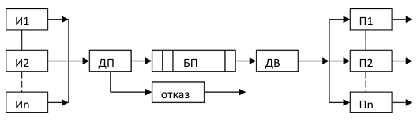

# Система обработки онлайн-платежей и транзакций интернет-банка (СМО)

Проект представляет собой программную имитационную модель системы массового обслуживания (СМО), предназначенную для исследования поведения вычислительных систем при различных конфигурациях. Модель позволяет оценивать ключевые метрики производительности (вероятность отказа, среднее время пребывания заявок, загрузку приборов) и подбирать оптимальные параметры архитектуры.

Каждый реальный объект узел обладает высокой сложностью, ножеством характеристик, внутренних и внешних свзей, поэтому для анализа его поведенческих характеристик целесообразно использовать имитационное моделирование. В данном проекте реализован **событийно-ориентированный подход** (принцип особых состояний), который в отличие от метода фиксированного шага `Δt`, обновляет состояние системы только в моменты наступления значимых событий (поступление заявки в СМО, освобождение прибора, окончание процесса моделирования), что является более эффективным.

## Архитектура и логика модели

Модель состоит из следующих абстрактных компонентов:
| Компонент | Описание |
|-----------|----------|
| **Источники (`Source`)** | Генерируют бесконечный поток заявок с равномерным законом распределения) |
| **Приборы (`Device`)** | Серверы обработки (экспоненциальное распределение времени обслуживания) |
| **Буфер (`Buffer`)** | Хранение очереди заявок |
| **Диспетчеры (`Dispatcher`)** | Логика маршрутизации: постановка в буфер и выбор свободного прибора |

  

### Дисциплины обслуживания
- **Запись в буфер:** по кольцу, если есть место. При переполнении срабатывает дисциплина отказа.
- **Отказ:** вытесняется самая старая заявка в буфере (актуально для систем, где старые данные теряют ценность).
- **Выборка на обслуживание:** LIFO (последняя поступившая заявка обслуживается первой).
- **Выбор прибора:** Round-Robin (по кольцу).
- **Приоритет событий:** при одновременном поступлении заявки и освобождении прибора приоритет отдаётся особому событию освобождения прибора.

**Пример технической системы, удовлетворяющей
формализованному описанию:** система обработки финансовых транзакций с различных каналов поступления, где важно обслуживать наиболее актуальные транзакции при высокой нагрузке и ограниченном буфере.

## Режимы работы системы
| Режим | Описание |
|------------|------------|
| Пошаговый | Визуализация формализованной схемы в реальном времени. Отображение текущих состояний буфера, приборов и заявок. |
| Автоматический | Полноценная симуляция до заданного числа заявок. Сбор статистики, построение графиков и вывод итоговых таблиц.|

## Технологический стек

| Компонент | Назначение |
|------------|------------|
| Язык | С++ |
| UI-фрейморк | Qt 6.9.2 |
| Система сборки | CMake | 
| Среда разработки и отладки | Visual Studio 2022